# AI Guardian Web Shield

AI Guardian Web Shield is a privacy-first browser security assistant that analyzes webpages, links, and search results locally to provide calm, plain-language risk guidance.

The extension helps users recognize potentially risky situations such as phishing attempts, suspicious links, misleading domains, and manipulative page behaviors while maintaining a strong commitment to privacy and accessibility.

AI Guardian Web Shield follows a local-first design philosophy, meaning analysis occurs on the user’s device whenever possible, reducing reliance on external data collection.

Risk scores are intended to provide guidance and awareness. They do not guarantee that a page is safe or unsafe.

## What's new in 1.2.0

- **Popup scan fixed.** The toolbar popup's first scan and "Scan Again" injected
  the page scripts without the behavior modules, so the page analysis crashed on
  any tab that had not already been scanned from the side panel. Both views now
  share one injection list in `shared/pageScripts.js`, and a partial injection no
  longer locks the page out of a later successful scan.
- **Review fixes.** Passcode panels now collapse, Labyrinth Guardian's rapid
  browsing prompts can fire again, webmail rows are no longer all flagged as
  risky, the sign-in bypass is limited to real webmail contexts, brand and
  lookalike checks stop flagging "purchase" or google.de, and "Go Back" on a
  warning no longer approves the next click. Full list in `CHANGELOG.md`.
- **Release tooling.** `npm run release` runs the tests, validates the manifest,
  injection order, syntax, versions and the no-network rule, then builds the
  Chrome Web Store zip in `dist/`. CI runs the same steps and attaches the zip.
- **Store listing copy** lives in `store/LISTING.md`, and the publishing steps in
  `RELEASING.md`. Full history is in `CHANGELOG.md`.

## Connected form actions (since 1.1.0)

Guardian combines sign-in field metadata, interactions with the same form,
the effective submission destination, and the intended submission method.
Warnings explain the connected actions and show whether an attempt was paused
or allowed to continue.

| Observed combination | Behavior |
| --- | --- |
| Sign-in field + GET submission | Warn: credentials could appear in a URL |
| Sign-in field + HTTP destination | Warn: the connection is not encrypted |
| Sign-in field interaction + changed external origin + submission | Warn: the destination changed |
| Sign-in field + external destination with other address warning signs | Warn: multiple signals agree |
| Ordinary HTTPS POST, including an external identity provider | No warning from cross-origin submission alone |

The evidence is held in memory for up to 90 seconds, with at most 64 events
and 8 findings. It uses generated form IDs and origins only. It does not read
field values or retain URL paths, queries, fragments, keystrokes, or request
bodies in the behavior history. Navigation to a new document resets that
history; a fragment-only change such as `#panel` routing on the same page keeps
it. Page reports still include the current page URL.

**Visibility:** this extension checks browser-visible forms on the page where
it has been activated. It cannot observe hidden AI-agent tool calls, JavaScript
credential reads, arbitrary fetch/XHR or native `form.submit()` calls, cross-page
redirect chains, or cross-origin frames. An attempted or continued submission
is not proof of a completed transfer. Page scripts can change or cancel actions
after an observed event, so this is guidance rather than a complete exfiltration
firewall. No new browser permissions are requested.

### Build, test and package

Requires Node.js 22 or newer. There are no runtime dependencies.

```bash
npm test
```

```bash
npm run check
```

```bash
npm run package
```

`npm run release` runs all three and writes `dist/ai-guardian-web-shield-<version>.zip`,
ready for the Chrome Web Store Developer Dashboard. See `RELEASING.md`.

For a manual Chrome check, load the extension using the Developer Mode steps
below. From the repository directory run `python3 -m http.server 8000`, open
`http://localhost:8000/tests/manual/behavior-forms.html`, activate Guardian on
that tab, and follow the fixture instructions. This fixture cancels all form
submissions; use invented values only. Automated Node tests do not replace a
Chrome extension smoke test.

---

# AI Guardian Web Shield is designed around three principles:

Calm security
Security tools should reduce anxiety, not increase it.

Local privacy
Browsing data should remain on the user's device whenever possible.

Human clarity
Security signals should be understandable without technical expertise.

---

# Screenshots

## Real-time risk scoring on webpages
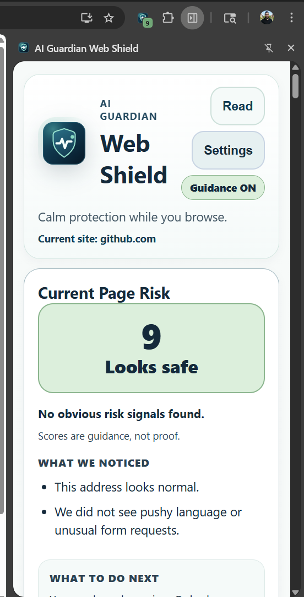

## Floating safety indicator for quick awareness
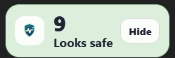

## Google search results with risk signals
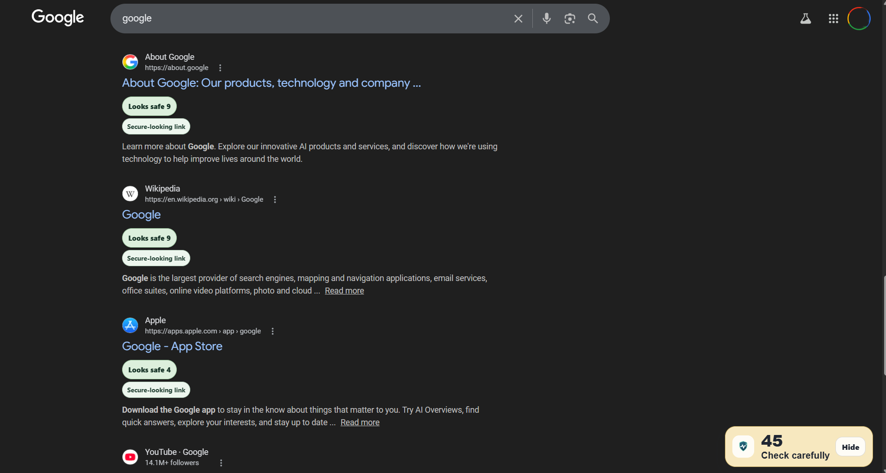

## Site identity and trust signals
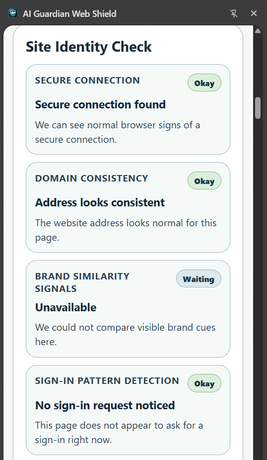

## Email safety preview detection
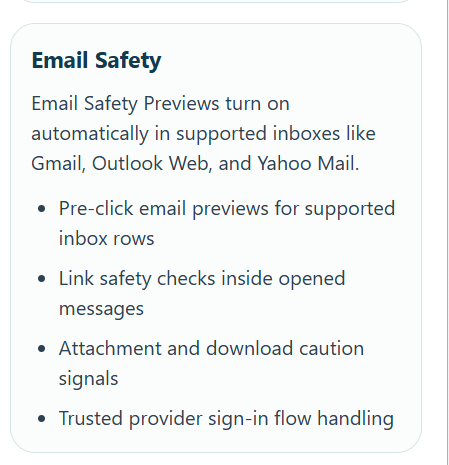

## Email risk warning example
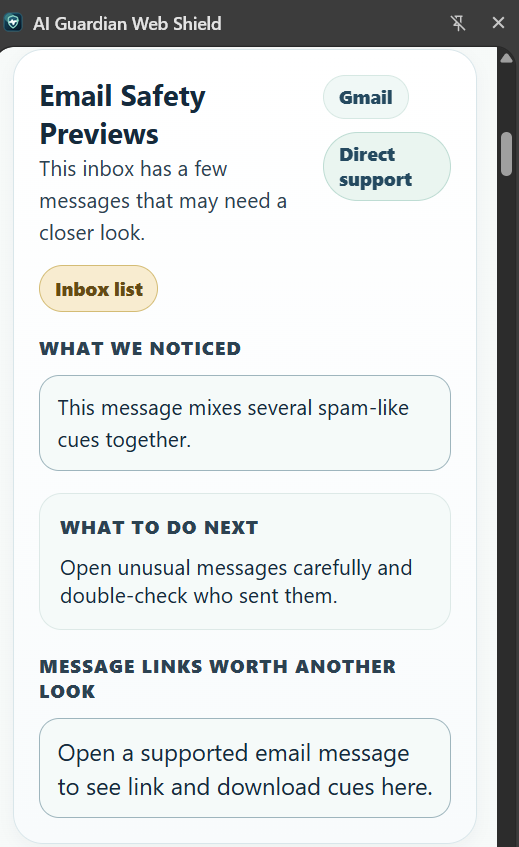

## Email message detail signals
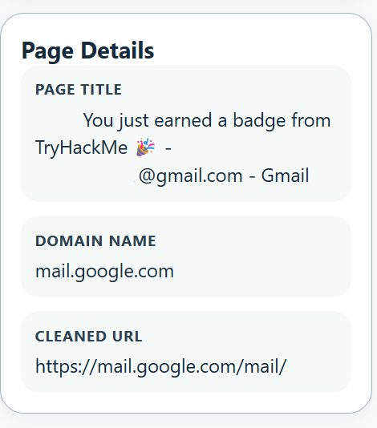

## Extension installed confirmation
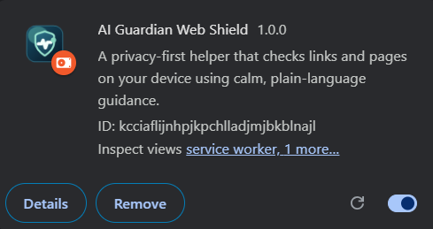

## Action tools panel
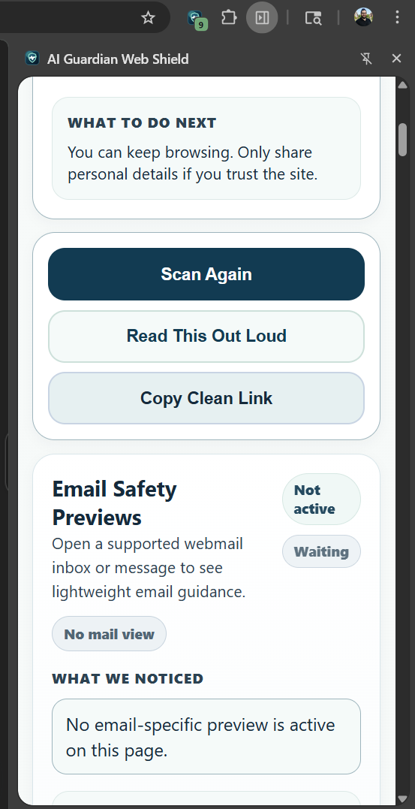

## Family protection controls
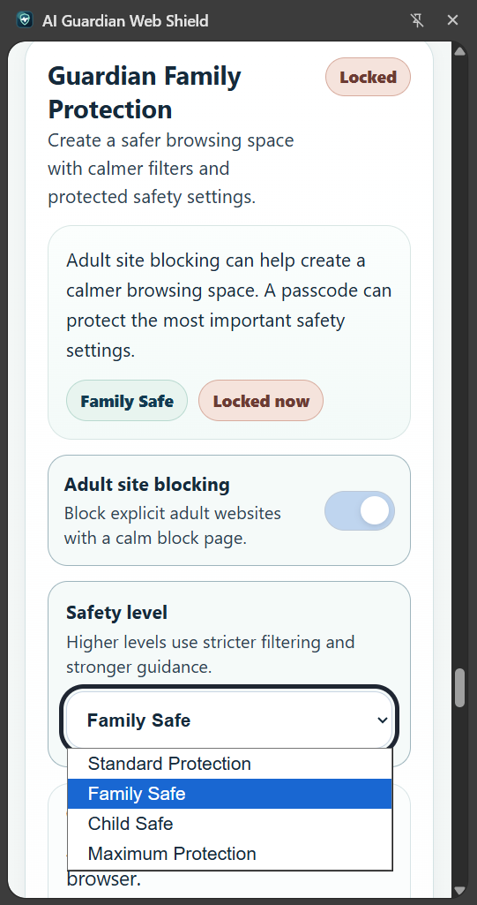

## Protected settings lock
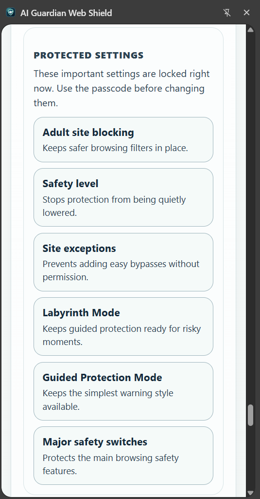

## Trusted adult review history
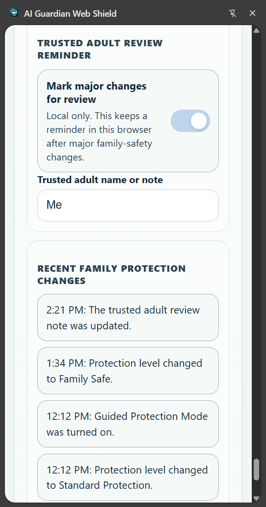

## Accessibility reading profiles
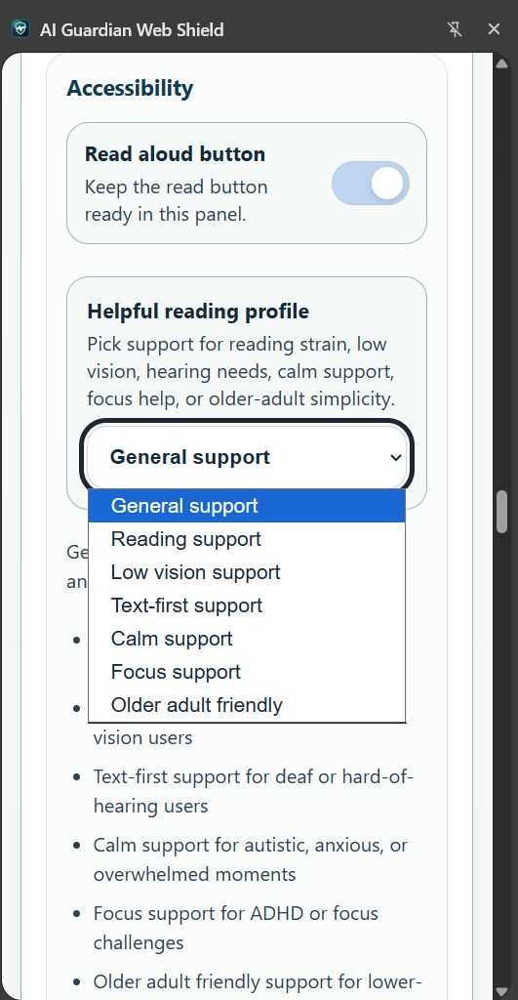

## Accessibility visual support settings
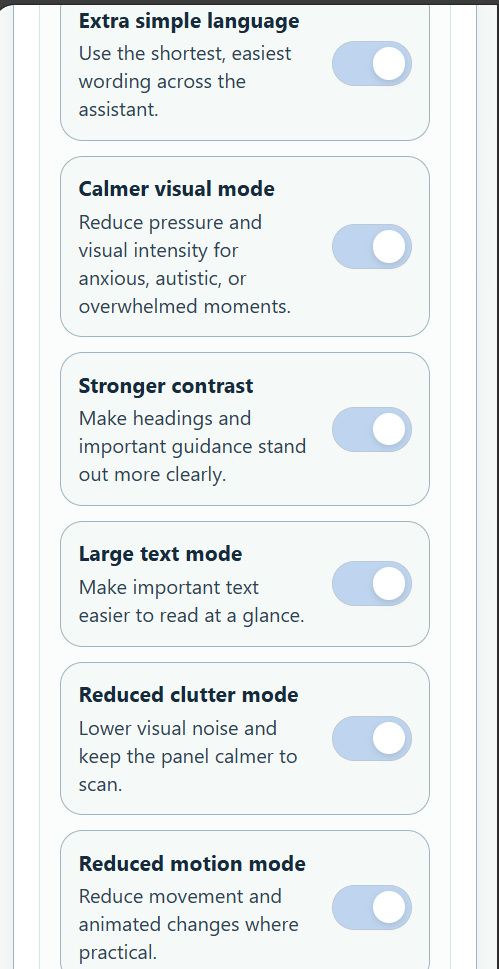

## Settings controls panel
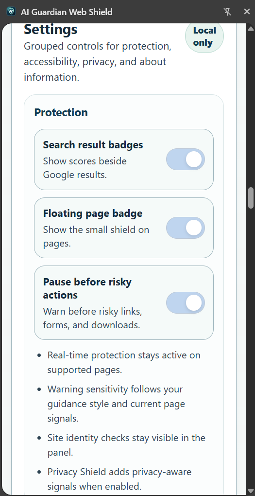

## Labyrinth Guardian slowdown protection
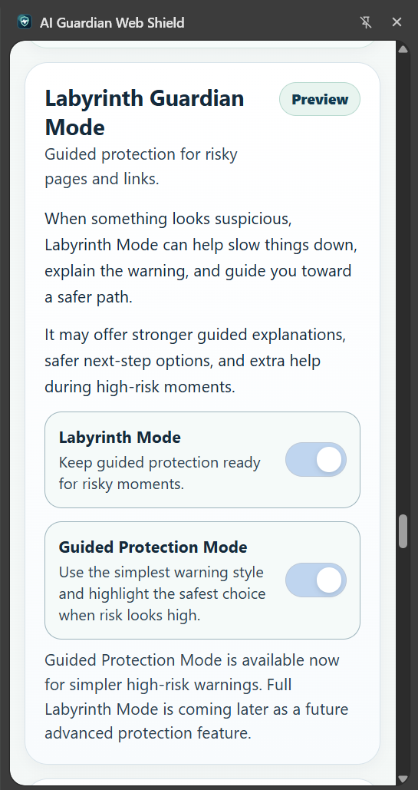

## Labyrinth protection style options
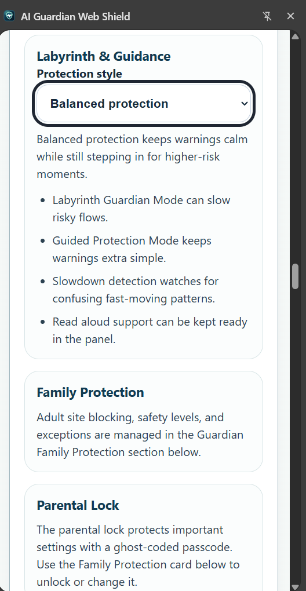

## Labyrinth protection dropdown
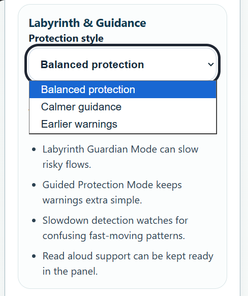

## AI Guardian Privacy Shield concept
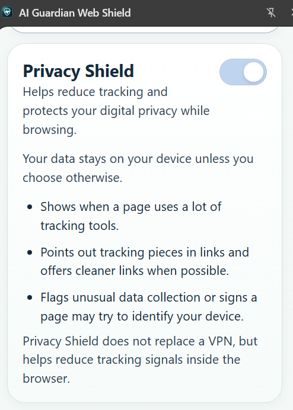

## Guardian ethics principles
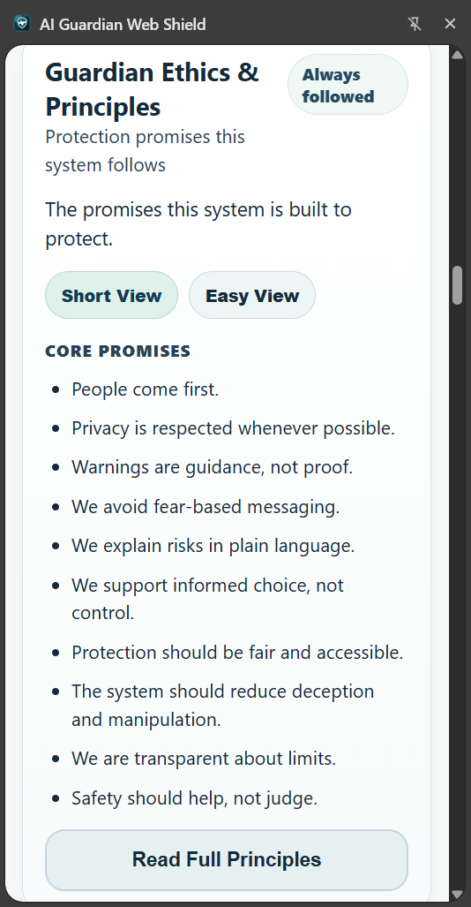

---

# Key Features

## Real-time risk awareness
AI Guardian Web Shield continuously evaluates pages and links using locally available signals and provides a simple risk score from 0–100.

Risk scoring helps users interpret situations such as:

• suspicious links  
• misleading domain names  
• potential phishing indicators  
• unusual page structures  
• risky download prompts  
• unexpected login requests  
• manipulative urgency language  

---

## Search result safety indicators
Google search results display score badges next to links to help users identify potentially risky destinations before clicking.

Badges provide early awareness of:

• suspicious domain structures  
• shortened or obfuscated URLs  
• unusual link patterns  
• high-risk page signals  

---

## Floating page safety indicator
Each supported page displays a small floating score badge for continuous awareness.

The floating badge:

• updates dynamically as page signals change  
• can be hidden for reduced visual clutter  
• opens detailed explanations when clicked  

---

## Site Identity Check
The popup includes a Site Identity Check panel that explains browser-visible trust signals such as:

• secure connection indicators (HTTPS presence)  
• domain consistency signals  
• login pattern observations  
• brand similarity cues when detectable  

This helps users interpret website trust signals without requiring technical knowledge.

---

## Email safety preview signals
The extension can highlight potentially suspicious messages in supported webmail environments.

Signals may include:

• unusual link patterns  
• suspicious formatting cues  
• mixed trust indicators  
• potential phishing characteristics  

---

## Labyrinth Guardian mode
Labyrinth Guardian introduces protective friction when browsing patterns suggest elevated risk.

Examples include:

• rapid navigation between risky pages  
• repeated exposure to suspicious links  
• high-risk interaction patterns  

Labyrinth Guardian may slow certain actions and provide additional context to support safer decisions.

---

## Privacy Shield design concept
The Privacy Shield concept focuses on reducing unnecessary tracking exposure within the browser by identifying:

• tracking-heavy link structures  
• excessive URL parameters  
• suspicious redirect patterns  

Privacy Shield is not a replacement for VPNs or network-layer tools but helps increase awareness of visible tracking signals.

---

## Guardian Family Protection
Guardian Family Protection introduces optional safety controls designed to support safer browsing environments.

Features include:

• adult site blocking using local signal combinations  
• adjustable safety levels  
• site exceptions  
• change history tracking  
• passcode protection for important settings  

The design aims to balance safety with access to legitimate educational, medical, legal, and support resources.

---

## Accessibility-first design
AI Guardian Web Shield includes multiple accessibility support options designed to reduce cognitive load and improve readability.

Available supports include:

• reading support profiles  
• reduced visual clutter mode  
• calmer visual presentation  
• strong contrast mode  
• large text mode  
• reduced motion mode  
• read-aloud capability  
• simplified language presentation  

These features aim to support users with:

• reading strain  
• ADHD  
• dyslexia  
• dysgraphia  
• low vision  
• anxiety  
• cognitive fatigue  

---

# Risk Score Labels

| Score | Guidance |
|------|----------|
| 0–19 | Looks safe |
| 20–39 | Low caution |
| 40–59 | Be careful |
| 60–79 | High caution |
| 80–100 | High risk |

Scores are informational guidance only.

Users should still apply independent judgment.

---

# Local-first security approach

AI Guardian Web Shield uses browser-visible signals and local analysis whenever possible.

Example signals include:

• domain structure characteristics  
• link length and complexity  
• shortened URL patterns  
• lookalike domain signals  
• presence of HTTPS indicators  
• form fields requesting credentials or sensitive information  
• suspicious download indicators  
• urgency or pressure language patterns  
• link tracking parameters  
• inconsistent page identity signals  

No browsing content is transmitted to external servers by default.

---

# Project structure

| Path | Purpose |
| --- | --- |
| `manifest.json` | Chrome extension configuration and permissions (Manifest V3, Chrome 116+). |
| `background.js` | Service worker: per-tab reports, settings, Family Protection passcode, side panel. |
| `content.js` | Page analysis, risk score, floating badge, search badges, proactive warnings. |
| `shared/` | Modules injected with `content.js`: behavior correlation and monitor, URL and DOM helpers, and `pageScripts.js`, the single injection list. |
| `email/` | Webmail provider detection, inbox and message scanning, email warning UI. |
| `popup.html`, `glance.js`, `glance.css` | Toolbar popup: quick score, Scan Again, Read Out Loud, open side panel. |
| `sidepanel.html`, `popup.js`, `popup.css` | Side panel: full explanations, settings, Family Protection, accessibility. |
| `icons/` | Extension icon assets and the SVG source. |
| `images/` | README screenshots (not packaged). |
| `scripts/check-extension.mjs` | Pre-release validator run by `npm run check`. |
| `scripts/package.mjs` | Builds the Web Store zip, run by `npm run package`. |
| `scripts/generate-icons.ps1` | PowerShell script for regenerating icon PNGs. |
| `tests/` | Node test suite plus a manual browser fixture. |
| `store/LISTING.md` | Chrome Web Store listing copy and permission justifications. |

---

# Installation (Developer Mode)

1. Open Chrome
2. Navigate to:

chrome://extensions

3. Enable Developer Mode
4. Select Load unpacked
5. Choose the ai-guardian-web-shield folder
6. Visit a website or perform a Google search
7. The floating safety badge and popup guidance will appear

---

# Privacy considerations

AI Guardian Web Shield is designed to minimize data exposure.

The current extension performs its analysis locally and has no telemetry or remote policy sync. Passcode records and personal review notes are restricted to the packaged extension controls. Content scripts receive read-only analysis preferences. See [Privacy Policy](Privacy%20Policy) for retained data and deletion, and [SECURITY.md](SECURITY.md) for trust boundaries and release checks. The local passcode is a convenience lock, not device-management enforcement or encryption.

Key principles:

• analysis occurs locally whenever possible  
• page content is not transmitted externally by default  
• minimal permissions are requested  
• guidance is informational, not authoritative  
• the extension does not replace antivirus software  
• the extension does not replace network-layer security tools  
• family protection operates locally in this version  
• trusted adult reminders are local-only in this version  
• browser extensions cannot guarantee full protection if a device is already compromised  

---

# Intended use

AI Guardian Web Shield is designed for:

• general users seeking clearer security signals  
• families supporting safer browsing habits  
• accessibility-aware browsing environments  
• cybersecurity awareness demonstrations  
• portfolio demonstration of defensive security design concepts  

---

# Relationship to Project Labyrinth

AI Guardian Web Shield complements Project Labyrinth by demonstrating applied defensive security design concepts in a browser environment.

Conceptual connections include:

• zero trust inspired evaluation  
• behavioral risk awareness  
• human-centered security guidance  
• privacy-first architecture thinking  

---
## Possible future improvements

- optional threat intelligence enrichment
- expanded phishing pattern detection
- improved brand impersonation similarity checks
- accessibility personalization profiles
- enterprise policy integration options
- optional encrypted sync of user preferences
- research testing for slowdown-based risk detection UX
---

# License

MIT License

